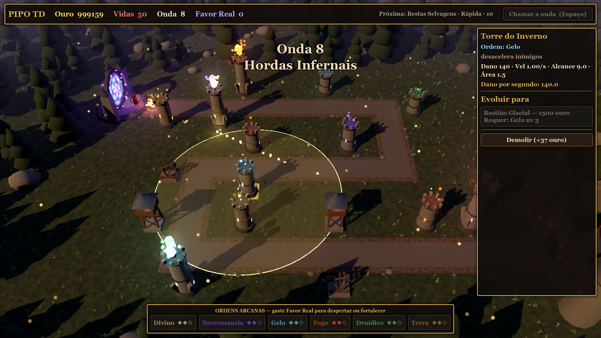
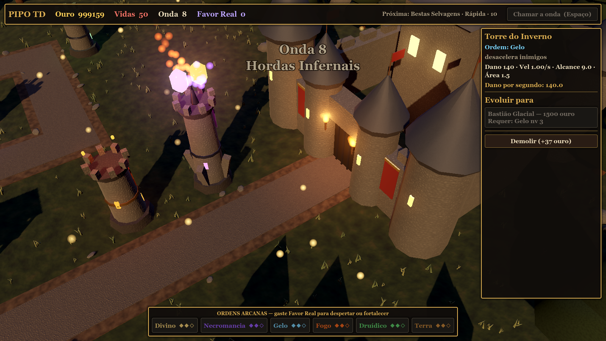
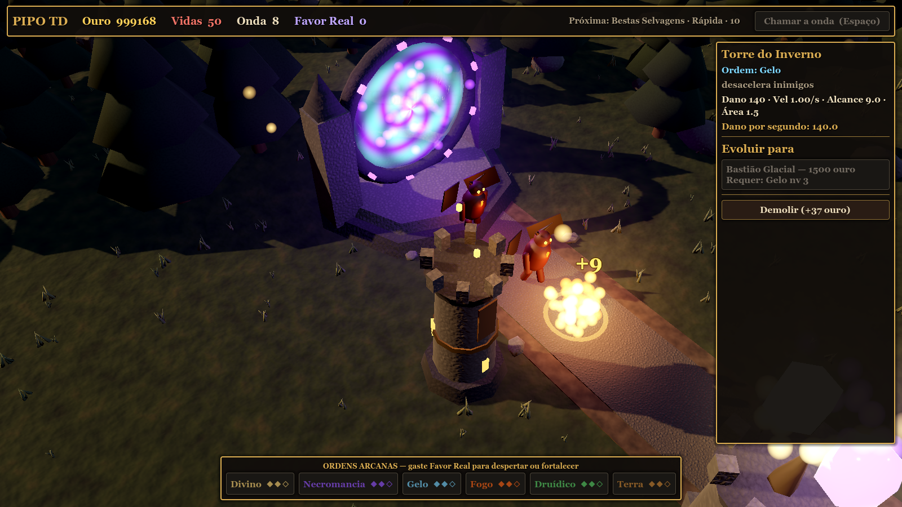
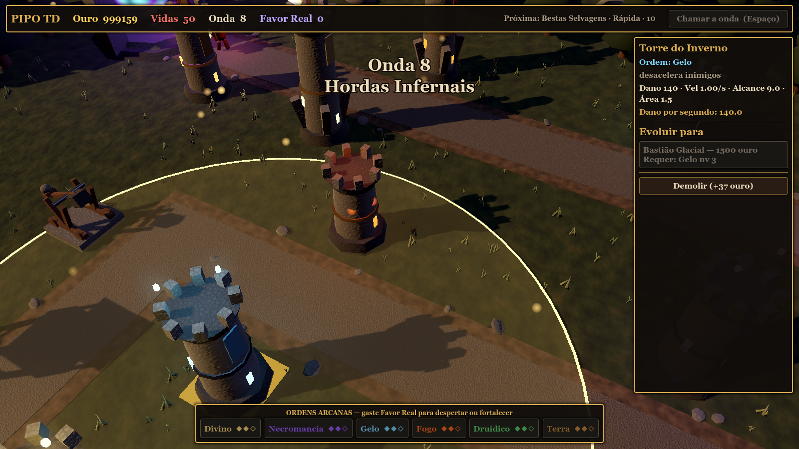
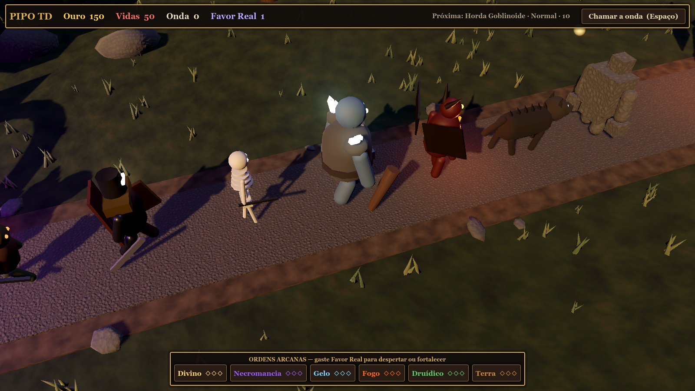

# Direção de arte

**Tema:** fantasia medieval mágica inspirada em D&D (conteúdo SRD 5.1), com tom **sombrio e adulto**, nada de visual infantil.

## Princípios
1. **Crepúsculo, não meio-dia.** Sol baixo e quente, céu azul-escuro com horizonte alaranjado e névoa ao longe. A luz principal vem do pôr do sol; a magia é o que brilha.
2. **Cores dessaturadas no mundo, saturadas na magia.** Pedra, madeira, grama e couro são escuros e foscos. Só cristais, runas, olhos, tochas e feitiços têm cor forte e brilho (*glow*).
3. **Cada Ordem tem uma cor** (em `data/elements.json → colors`), usada em cristais, janelas das torres, projéteis, partículas e olhos dos inimigos daquela facção.
4. **Silhuetas legíveis de cima.** A câmera é de estratégia: as torres crescem e ganham detalhes a cada nível, e os chefes têm coroa e aura.
5. **Tudo procedural por enquanto.** Não há arquivos de modelo nem de textura: formas e texturas (ruído) são geradas por código. Isso permite iterar rápido; modelos 3D de verdade virão na Fase 5 (ver [todo.md](todo.md)).

## Paleta das Ordens
| Ordem (id) | Nome na tela | Cor | Partículas |
|---|---|---|---|
| `sagrado` | Divino | dourado `#ffd77a` | sobem devagar (luz sagrada) |
| `necromancia` | Necromancia | violeta `#9b5cff` | grandes, sobem (almas) |
| `gelo` | Gelo | azul-gelo `#7fd8ff` | caem (neve) |
| `fogo` | Fogo | laranja `#ff6a1f` | sobem rápido (fagulhas) |
| `druidico` | Druídico | verde `#5fd16a` | caem devagar (folhas/esporos) |
| `pedra` | Terra | âmbar `#d08a3a` | caem rápido (poeira) |
| (sem Ordem) | — | cinza `#9a9184` | poucas |

O comportamento das partículas fica em `Art.ORDER_FX` (`scripts/visual/art.gd`).

## Cenário
`scripts/visual/world_builder.gd`, configurado por `scenery` em `data/maps/<id>.json`.

| Elemento | Como é feito |
|---|---|
| Céu | `ProceduralSkyMaterial` crepuscular |
| Luz | sol quente (com sombras) + luz de preenchimento azulada |
| Pós-processamento | tonemap Filmic, SSAO (sombra de contato), glow (brilho), névoa por distância, leve contraste |
| Terreno | plano grande com textura de grama por ruído |
| Estrada | calçamento (ruído celular = pedras) sobre borda de terra, com pedrinhas soltas |
| Portal (entrada) | anel de pedra com runas violetas, redemoinho animado (`shaders/portal.gdshader`), luz e partículas |
| Castelo (saída) | muralhas com ameias, 4 torres de canto, torre de menagem, portão com grade, estandartes vermelhos, tochas |
| Floresta | ~420 pinheiros fora da área jogável (MultiMesh) |
| Rochas, grama | MultiMesh com variação de tamanho e cor |
| Montanhas | cones com neve ao fundo, apagados pela névoa |
| Ar | partículas douradas flutuando (vagalumes / poeira arcana) |

## Torres
`scripts/visual/tower_model.gd`

| Camada | Visual |
|---|---|
| Arqueiros | torre de vigia de madeira sobre base de pedra, telhado de ardósia, arqueiro encapuzado, lanterna |
| Catapulta | estrutura de madeira com rodas e braço que **dispara** (animação) |
| Ordem nv 1 | torre de pedra com ameias, janelas brilhando na cor da Ordem, **cristal flutuante** girando |
| Ordem nv 2 | mais alta + estandarte + fragmentos orbitando o cristal |
| Ordem nv 3 | ainda mais alta + contrafortes + 3 fragmentos |
| Dual | a mais alta, pináculo central e **dois cristais** (um de cada Ordem) orbitando |

O cristal e a luz da torre **piscam** a cada disparo. Selecionada, a torre mostra um anel dourado com o alcance.

## Inimigos (facções)
`scripts/visual/enemy_model.gd`. Cada Ordem de onda corresponde a uma facção (`elements.json → factions`):

| Ordem | Facção | Modelo | Chefe |
|---|---|---|---|
| sem Ordem | Horda Goblinoide | goblin curvado com orelhas pontudas e lâmina | Senhor da Guerra Hobgoblin |
| Divino | Cruzados Caídos | cavaleiro de armadura escura, viseira brilhante, capa e escudo | Paladino Caído |
| Necromancia | Legião Morta-Viva | esqueleto com lança | Lich |
| Gelo | Gigantes do Gelo | gigante peludo com cristais de gelo nos ombros e porrete | Jarl dos Gigantes do Gelo |
| Fogo | Hordas Infernais | demônio com chifres, asas e veias incandescentes | Senhor Demônio |
| Druídico | Bestas Selvagens | worg quadrúpede com crina de espinhos | Urso-Coruja Alfa |
| Terra | Constructos de Pedra | golem de blocos com rachaduras brilhando | Golem Ancião |

- Olhos brilham na cor da Ordem.
- Ondas **blindadas** ganham ombreiras e peitoral de metal.
- **Chefes**: maiores, com coroa dourada, aura de partículas e luz própria.
- Animação de caminhada (pernas/braços balançando). Atordoado = parado.
- Barra de vida só aparece depois do primeiro dano.

## Efeitos
`scripts/visual/vfx.gd` e `scripts/entities/projectile.gd`
- **Flecha** (Arqueiros) voa reta; **pedra** (Catapulta) faz arco e gira; **magia** é um orbe brilhante com rastro de partículas e luz.
- Impacto: explosão de partículas + clarão. Dano em área: anel de onda de choque.
- Morte: explosão na cor da facção + "+ouro" dourado subindo.

## Interface
`scripts/ui/hud.gd`: painéis quase pretos com **borda dourada**, fonte serifada do sistema (Cinzel se instalada; senão Georgia), texto cor de pergaminho, anúncio grande no começo de cada onda ("Onda 8 — Hordas Infernais"). Os níveis das Ordens aparecem como ◆◆◇.

## Como revisar o visual
Gere capturas de tela sem jogar (ver [testing.md](testing.md#capturas-de-tela)).
