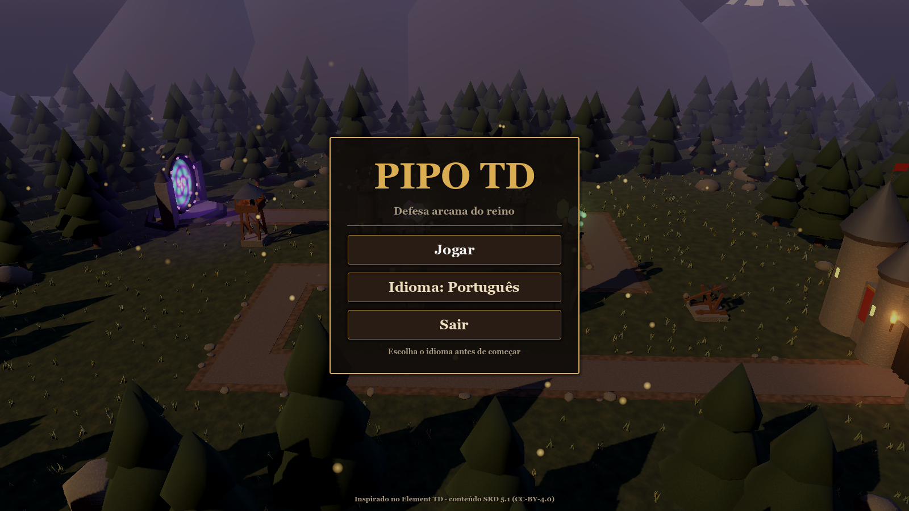

# Sistema: Menu principal

**Cena:** `scenes/menu.tscn` (é a **cena inicial** do jogo, em `project.godot → run/main_scene`)
**Código:** `scripts/ui/menu.gd`

## O que tem
| Elemento | Ação |
|---|---|
| Título + subtítulo | — |
| **Jogar** / Play | abre `scenes/main.tscn` (a partida) |
| **Idioma: Português** / Language: English | alterna para o próximo idioma de `Loc.LANGUAGES` e salva (ver [localization.md](localization.md)) |
| **Sair** / Quit | fecha o jogo |
| Rodapé | créditos (Element TD, SRD 5.1) |

## Fundo
O mapa 1 montado pelo `WorldBuilder` (o mesmo cenário da partida), com torres decorativas (`DECOR_TOWERS`) e a câmera girando devagar em volta. É só visual: não há ondas nem lógica.

## Voltar ao menu durante o jogo
Botão **Menu** na barra superior do HUD, ou **Menu principal** na tela de vitória/derrota.
