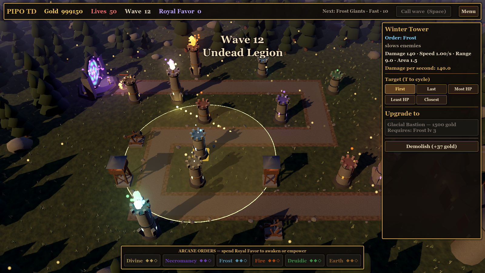

# Sistema: Torres

**Código:** `scripts/entities/tower.gd` (classe `Tower`), `scripts/entities/projectile.gd`, ações em `scripts/world/main.gd`
**Dados:** `data/towers.json` · lista e árvore de design em [../towers.md](../towers.md)

## Ciclo de vida
1. **Construir** (`main._on_build`): só torres com `tier: "base"`. Cobra `cost`, coloca a `Tower` na célula selecionada da grade (`BuildGrid.place_tower`).
2. **Atirar** (`_process`): quando o tempo de recarga zera, procura alvo; se achar, cria um projétil e recarrega por `1 / attack_speed` segundos.
3. **Evoluir** (`main._on_upgrade`): o painel lista `upgrades_to`. Exige `requires` (níveis de Ordem) e cobra o `cost` cheio da torre nova (decisão D-008). A torre troca de `tower_id` no lugar.
4. **Vender** (`main._on_sell`): devolve `total_spent × sell_refund` (75%).

## Mira (escolhida pelo jogador)
Cada torre tem seu próprio modo de mira (`Tower.targeting`). O jogador troca no painel da torre (5 botões) ou com a tecla **T** (passa para o próximo). O modo **continua igual quando a torre evolui**. O modo inicial vem do campo `targeting` em `towers.json` (hoje `first` em todas).

Entre os inimigos vivos dentro do `range` (distância no plano X/Z), a torre escolhe pela "nota" (`_score`):

| Modo | Nome na tela | Escolhe |
|---|---|---|
| `first` | Da frente / First | o mais adiantado na rota (mais perto do castelo) |
| `last` | De trás / Last | o mais atrás na rota |
| `strongest` | Mais HP / Most HP | o que tem mais vida atual |
| `weakest` | Menos HP / Least HP | o que tem menos vida atual |
| `closest` | Mais próximo / Closest | o mais perto da torre |

Empate: fica o mais adiantado na rota. Funções: `find_target(range)`, `set_targeting(mode)`, `cycle_targeting()`; sinal `targeting_changed`.

## Projétil
- Velocidade fixa de 28 m/s; persegue o alvo.
- Se o alvo morrer no caminho, vai até a última posição e explode lá.
- `splash_radius > 0`: acerta todos os inimigos nesse raio do ponto de impacto. Senão, só o alvo.
- Dano, Ordem e habilidade são copiados da torre no momento do disparo.

## Números sempre do JSON
`data()` devolve o dicionário da torre em `GameData` a cada uso. Depois de editar `towers.json`, aperte **F5** no jogo: torres já construídas passam a usar os valores novos e o visual é refeito.

## Visual
`scripts/visual/tower_model.gd` (classe `TowerModel`): torre de vigia, catapulta animada, torres de pedra com cristal flutuante na cor da Ordem, Duais com dois cristais. O cristal pisca ao disparar. Anel dourado mostra o alcance quando selecionada. O estilo do projétil (`arrow`, `boulder`, `magic`) sai de `_projectile_style`. Detalhes em [../art-direction.md](../art-direction.md#torres).

## Campos usados
`id`, `name`, `tier`, `element`, `cost`, `damage`, `attack_speed`, `range`, `splash_radius`, `ability`, `requires`, `upgrades_to`, `role`. Detalhes em [../data-reference.md](../data-reference.md).
